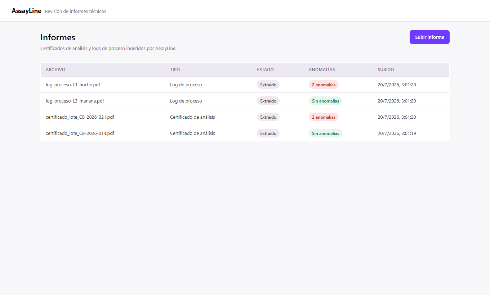
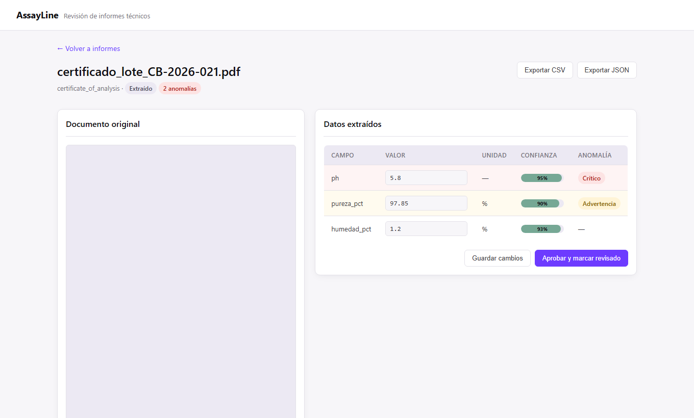
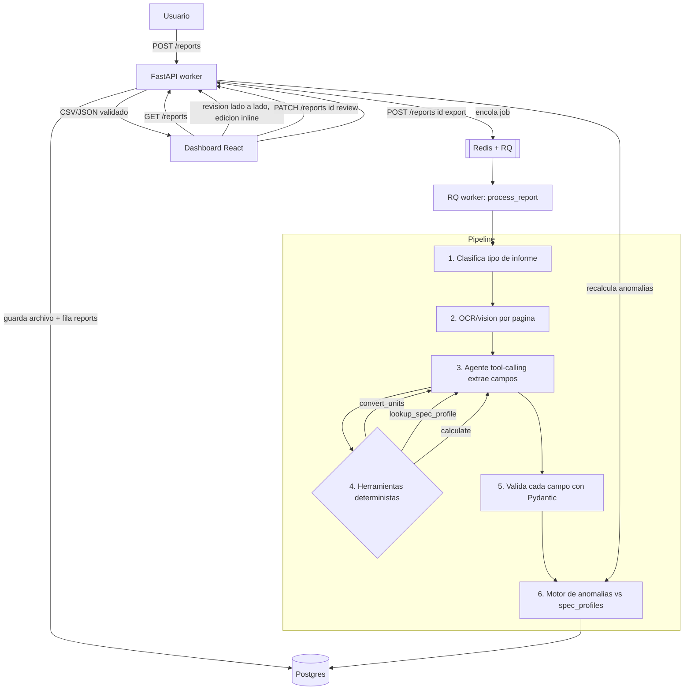

# AssayLine

Pipeline agéntico que convierte informes técnicos industriales y de
laboratorio desordenados (PDF, escaneos, fotos, tablas mal formadas) en
datos estructurados y validados, marca anomalías fuera de especificación, y
permite revisión **human-in-the-loop** antes de exportar.

Combina un agente con tool-calling (herramientas deterministas para
conversión de unidades, lookup de especificaciones y cálculo), visión
multimodal para escaneos y gráficas, y validación de esquema campo por campo
con Pydantic — nunca se confía en el output crudo de un LLM sin verificar.

## Índice

- [Cómo se ve](#cómo-se-ve)
- [Arquitectura](#arquitectura)
- [Stack](#stack)
- [Endpoints](#endpoints)
- [Desarrollo local](#desarrollo-local)
- [Tests](#tests)
- [Deploy](#deploy)
- [Decisiones de diseño](#decisiones-de-diseño)

## Cómo se ve

| Lista de informes con badges de anomalía | Revisión lado a lado con edición inline |
|---|---|
|  |  |

Datos 100% sintéticos — ver [`worker/app/demo/data.py`](worker/app/demo/data.py).

## Arquitectura



Ver el razonamiento detrás de cada decisión (por qué tool-calling en vez de
extracción directa, por qué human-in-the-loop, cómo se manejan outputs de
LLM no fiables) en [`DECISIONS.md`](DECISIONS.md).

## Stack

| Capa | Tecnología |
|---|---|
| Worker | Python + FastAPI, agente con tool-calling (Anthropic tool use), visión multimodal, validación con Pydantic |
| Cola de jobs | Redis + RQ |
| Base de datos | Postgres (`reports`, `extractions`, `anomalies`, `reviews`, `spec_profiles`) vía SQLAlchemy + Alembic |
| Dashboard | React + Vite + TypeScript + react-router-dom |
| Deploy | Railway (worker + Postgres + Redis) + Vercel (dashboard) |

## Endpoints

| Método | Ruta | Qué hace |
|---|---|---|
| `POST` | `/reports` | Sube un informe (PDF/PNG/JPG), lo encola para ingesta |
| `GET` | `/reports` | Lista informes con estado y resumen de anomalías (filtrable por `status`) |
| `GET` | `/reports/{id}` | Estado + extracción + anomalías de un informe |
| `GET` | `/reports/{id}/original` | Sirve el archivo original (para la vista lado a lado) |
| `PATCH` | `/reports/{id}/review` | Aplica correcciones humanas; con `approve: true` recalcula anomalías |
| `POST` | `/reports/{id}/export?format=json\|csv` | Export validado |
| `GET` | `/schemas` | Campos conocidos por tipo de informe (derivados de `spec_profiles`) |

## Desarrollo local

```bash
cp .env.example .env
docker compose -f infra/docker-compose.yml up -d   # Postgres + Redis

cd worker
python -m venv .venv && .venv/Scripts/activate      # o source .venv/bin/activate
pip install -e ".[dev]"
alembic upgrade head                                 # crea el schema
uvicorn app.main:app --reload                        # API en :8000
rq worker ingestion --url redis://localhost:6379/0    # worker de ingesta (otra terminal)
python -m scripts.seed_demo                           # spec_profiles + 4 informes demo

cd ../dashboard
cp ../.env.example .env                                # o crea uno con VITE_API_BASE_URL
npm install
npm run dev                                            # dashboard en :5173
```

El schema de Postgres vive como migraciones de **Alembic** en
[`worker/alembic/`](worker/alembic/) — fuente única de verdad, generada a
partir de los modelos SQLAlchemy en `worker/app/models/`.

## Tests

```bash
cd worker && pytest -q && ruff check .   # 49 tests: unit + integración
cd dashboard && npm run build            # incluye typecheck (tsc -b)
```

Los tests de integración corren contra SQLite (fixture en `tmp_path`) +
`fakeredis` con una cola RQ síncrona, sin necesitar Postgres/Redis reales ni
llamadas a la API de Anthropic — ver el porqué en `DECISIONS.md` (§9).
Incluyen un fixture PDF sintético real (generado con PyMuPDF) para el
pipeline completo de ingesta.

## Deploy

- **Worker** (Railway): API FastAPI + proceso `rq worker ingestion` +
  Postgres + Redis gestionados. Variables de entorno en `.env.example`.
- **Dashboard** (Vercel): build estático de Vite. Solo necesita
  `VITE_API_BASE_URL` apuntando al worker desplegado.
- Antes del primer deploy: `alembic upgrade head` contra la base de Railway,
  luego `python -m scripts.seed_demo` para poblar los datos de demo.

## Decisiones de diseño

Ver [`DECISIONS.md`](DECISIONS.md) — por qué tool-calling en vez de
extracción directa, por qué la validación es campo por campo, por qué el
motor de anomalías recalcula tras cada revisión humana, y qué falta para
ser "producción de verdad".

## Hitos

1. [x] Scaffolding monorepo + schema Postgres + docker-compose + CI
2. [x] Ingesta: `POST /reports` + clasificación + OCR/visión
3. [x] Agente de extracción con tool-calling + validación Pydantic
4. [x] Motor de anomalías + informes sintéticos de demo
5. [x] Dashboard de revisión (lado a lado, edición inline, export)
6. [x] README senior + diagrama Mermaid + `DECISIONS.md`
