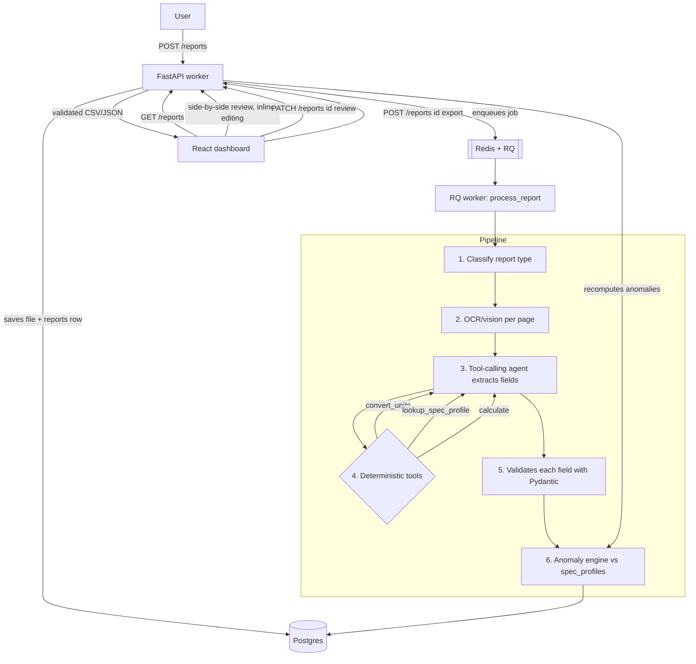

# AssayLine

> **Hiring manager / technical reviewer?** Read the [2-minute technical overview](REVIEWER_GUIDE.md) for code pointers, capabilities and limitations.

Agentic pipeline that turns messy industrial/lab technical reports (PDF,
scans, photos, badly formatted tables) into structured, validated data,
flags out-of-specification anomalies, and supports **human-in-the-loop**
review before export.

Combines a tool-calling agent (deterministic tools for unit conversion,
spec lookup, and calculation), multimodal vision for scans and charts, and
field-by-field schema validation with Pydantic — raw LLM output is never
trusted without verification.

## Table of contents

- [What it looks like](#what-it-looks-like)
- [Architecture](#architecture)
- [Stack](#stack)
- [Endpoints](#endpoints)
- [Local development](#local-development)
- [Tests](#tests)
- [Deploy](#deploy)
- [Design decisions](#design-decisions)

## What it looks like

| Report list with anomaly badges | Side-by-side review with inline editing |
|---|---|
|  |  |

100% synthetic data — see [`worker/app/demo/data.py`](worker/app/demo/data.py).

## Architecture



See the reasoning behind each decision (why tool-calling instead of direct
extraction, why human-in-the-loop, how unreliable LLM outputs are handled)
in [`DECISIONS.md`](DECISIONS.md).

## Stack

| Layer | Technology |
|---|---|
| Worker | Python + FastAPI, tool-calling agent (Anthropic tool use), multimodal vision, Pydantic validation |
| Job queue | Redis + RQ |
| Database | Postgres (`reports`, `extractions`, `anomalies`, `reviews`, `spec_profiles`) via SQLAlchemy + Alembic |
| Dashboard | React + Vite + TypeScript + react-router-dom |
| Deploy | Railway (worker + Postgres + Redis) + Vercel (dashboard) |

## Endpoints

| Method | Path | What it does |
|---|---|---|
| `POST` | `/reports` | Uploads a report (PDF/PNG/JPG), enqueues it for ingestion |
| `GET` | `/reports` | Lists reports with status and anomaly summary (filterable by `status`) |
| `GET` | `/reports/{id}` | Status + extraction + anomalies for a report |
| `GET` | `/reports/{id}/original` | Serves the original file (for the side-by-side view) |
| `PATCH` | `/reports/{id}/review` | Applies human corrections; with `approve: true` recomputes anomalies |
| `POST` | `/reports/{id}/export?format=json\|csv` | Validated export |
| `GET` | `/schemas` | Known fields per report type (derived from `spec_profiles`) |

## Local development

```bash
cp .env.example .env
docker compose -f infra/docker-compose.yml up -d   # Postgres + Redis

cd worker
python -m venv .venv && .venv/Scripts/activate      # or source .venv/bin/activate
pip install -e ".[dev]"
alembic upgrade head                                 # creates the schema
uvicorn app.main:app --reload                        # API on :8000
rq worker ingestion --url redis://localhost:6379/0    # ingestion worker (separate terminal)
python -m scripts.seed_demo                           # spec_profiles + 4 demo reports

cd ../dashboard
cp ../.env.example .env                                # or create one with VITE_API_BASE_URL
npm install
npm run dev                                            # dashboard on :5173
```

The Postgres schema lives as **Alembic** migrations in
[`worker/alembic/`](worker/alembic/) — single source of truth, generated
from the SQLAlchemy models in `worker/app/models/`.

## Tests

```bash
cd worker && pytest -q && ruff check .   # 49 tests: unit + integration
cd dashboard && npm run build            # includes typecheck (tsc -b)
```

Integration tests run against SQLite (fixture in `tmp_path`) + `fakeredis`
with a synchronous RQ queue, with no need for real Postgres/Redis or calls
to the Anthropic API — see the reasoning in `DECISIONS.md` (§9). They
include a real synthetic PDF fixture (generated with PyMuPDF) for the full
ingestion pipeline.

## Deploy

- **Worker** (Railway): FastAPI API + `rq worker ingestion` process +
  managed Postgres + Redis. Environment variables in `.env.example`.
- **Dashboard** (Vercel): static Vite build. Only needs
  `VITE_API_BASE_URL` pointing at the deployed worker.
- Before the first deploy: `alembic upgrade head` against the Railway
  database, then `python -m scripts.seed_demo` to seed the demo data.

## Design decisions

See [`DECISIONS.md`](DECISIONS.md) — why tool-calling instead of direct
extraction, why validation happens field-by-field, why the anomaly engine
recomputes after every human review, and what's still missing to call this
"real production".

## Milestones

1. [x] Monorepo scaffolding + Postgres schema + docker-compose + CI
2. [x] Ingestion: `POST /reports` + classification + OCR/vision
3. [x] Tool-calling extraction agent + Pydantic validation
4. [x] Anomaly engine + synthetic demo reports
5. [x] Review dashboard (side-by-side, inline editing, export)
6. [x] Senior README + Mermaid diagram + `DECISIONS.md`
